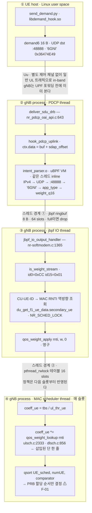

# Janus × OAI 후킹 경로

> **작성일** 2026-10-14
> **대상 트리** `OAI-gNB` @ `feature/jbpf-mac-scheduler-hooks` · `jbpf` @ `b15dd030` (MIT)
> **환경** band 78 · 100 MHz · 273 PRB · 30 kHz SCS · TDD `DDDDDDDSUU` · USRP X410

Microsoft **jbpf**(Project Janus)가 OpenAirInterface gNB에 결합된 방식, UE가 쏜
**demand6 intent 패킷**이 MAC 스케줄러의 PF 가중치로 바뀌는 경로, 그리고 지금 트리에서
**정리가 필요한 11개 지점**을 소스 레벨로 정리한 레퍼런스.

> ⚠️ 본문의 행 번호는 작성 시점 기준이다. 인용 전 `grep`으로 재확인할 것.

---

## 목차

0. [변경 이력 — 2026-10-14 적용](#0-변경-이력--2026-10-14-적용) · 코드 정리 9개 + jbpf vendoring
1. [요약](#1-요약)
2. [jbpf — 특징과 주요 기능](#2-jbpf--특징과-주요-기능)
3. [OAI와의 결합 — 3개 층위](#3-oai와의-결합--3개-층위)
4. [데모 경로 — demand6에서 PRB까지](#4-데모-경로--demand6에서-prb까지)
5. [사용법](#5-사용법)
6. [코드렛 인벤토리](#6-코드렛-인벤토리)
7. [정리가 필요한 지점](#7-정리가-필요한-지점)
8. [저장소 통합과 라이선스](#8-저장소-통합과-라이선스)
9. [GPU 자원까지 묶는 확장 스케치](#9-gpu-자원까지-묶는-확장-스케치)
10. [파일 지도](#10-파일-지도)

---

## 0. 변경 이력 — 2026-10-14 적용

7장에서 찾은 11개 중 **9개를 적용**했다. 데모 로직(한 UE 에 자원을 몰아주는 PF
가중치 방식)은 그대로 두고, 중복·죽은 코드·상태 누출만 정리했다.

| ID | 조치 | 파일 |
|---|---|---|
| F-02 | 코드렛이 **weight 변화 시에만** push → 정상 상태 0 msg/s | `intent_parser.c` |
| F-03 | 상태 맵 `ARRAY(1칸)` → **`HASHMAP` keyed by `ue_id`** | `intent_parser.c` |
| F-04 | `weight == 1.0` → 엔트리 비활성화 (OFF 가 진짜 리셋). `app_type 255` 로 전체 해제 경로 신설 | `qos_weight.c`, `intent_parser.c`, `nr-softmodem.c` |
| F-05 | 엔트리에 `rnti` 저장 → 해시 충돌이 오적용 대신 1.0 으로 떨어짐 | `qos_weight.c` |
| F-06 | 영구 엔트리에서 `clock_gettime()` 단축 평가로 제거 | `qos_weight.c` |
| F-07 | ctx 구조체 중복 **9곳 제거** → `pdcp_hook_ctx.h` 신설 + `mac_scheduler_hooks.h` 공유 | 헤더 2개 + 코드렛 8개 + `nr_pdcp_oai_api.c` |
| F-08 | 빌드 목록을 **`codelets.list` 한 곳**으로 → CMake/Makefile 드리프트 제거. 코드렛 10개 전부 빌드 | `codelets.list`, `Makefile`, `CMakeLists.txt` |
| F-09 | 중복 shim `libdemand_hook.c` 삭제, 환경변수 버전만 남김. `DEMAND_DST_IP` 추가 | `ue/Makefile`, `ue/demand_runtime.c` |
| F-10 | `codelet.sh` 신설 — 로드/언로드 단일 진입점. 기존 두 스크립트는 얇은 래퍼 | `~/codelet.sh` |

**미적용 2개** (의도적):

- **F-01** — 코드 변경 없음. UE 2대 경합이 데모의 전제라는 *사실*이고, 가중치를
  PRB 양에 꽂는 fix B 는 PF 공정성을 깨므로 별도 논의 대상.
- **F-11** — ctrl hook 전환은 논문 단계 과제. 지금 구조가 baseline 이다.

### 작업 중 새로 발견한 3개

| 내용 | 조치 |
|---|---|
| `jbpf_printf_debug()` 의 실제 게이트는 **`JBPF_DEBUG_ENABLED`** 인데 CFLAGS 에 없었다 → **모든 코드렛의 디버그 출력이 `((void)0)` 으로 죽어 있었다** (`header_parser.c` 의 unused-variable 경고가 그 흔적) | `make DEBUG=1` / `-DJBPF_CODELET_DEBUG=ON` 노브 추가. fast path 비용 때문에 기본값은 off |
| `codelets/common.h` 가 `IPPROTO_TCP/UDP` 를 재정의해 호스트 빌드에서 경고 | `#ifndef` 가드 |
| `print_hex_line()` 이 hex/ascii 문자열을 조립하고 **출력이 주석 처리돼 있어 그대로 버렸다** (SR 50회/BSR 100회마다 낭비) | `LOG_I` 복원 |

### jbpf vendoring (2026-10-14 적용)

8장의 C 옵션을 실행했다. `third_party/jbpf` 가 submodule 에서 저장소가
직접 추적하는 일반 파일로 바뀌었다 — 커밋 `ebdd5bf2`, 4512 파일 / 565k 라인.

| 항목 | 내용 |
|---|---|
| 제거 | `.gitmodules` 의 jbpf 항목, 중첩 `.git` 포인터 **23개**(최대 5단계 깊이), `.git/modules/third_party/jbpf` (139 M) |
| 커밋 | 소스 4507 + `UPSTREAM.md` + `.gitattributes` = **4509 파일, 118 M** |
| 제외 | `build/` (94 M) · `out/` (25 M) — `.gitignore` |

작업 중 발견한 함정 세 개:

1. **`git submodule deinit -f` 를 쓰면 안 된다** — 워킹 트리를 삭제한다.
   패치 적용된 `3p/` 전체와 빌드된 `libjbpf.so` 가 날아간다.
   `git rm --cached` 가 맞다 (인덱스만 건드리고 파일은 남긴다).
2. **vendored 트리 내부의 `.gitignore` 가 활성화된다.** jbpf 의 `build`,
   `tests`, `*.o` 패턴이 **`3p/ck/build/`(ck 의 실제 빌드 시스템)** 등
   소스 1168개를 막았다. `git add -f` 로 강제 추가해 업스트림 워킹 트리와
   동일한 파일 집합을 유지했다.
3. **`init_and_patch_submodules.sh` 가 configure 중에 호출된다**
   (`jbpf/CMakeLists.txt:46` 의 `execute_process`, 0 아니면 `FATAL_ERROR`).
   처음에 가드를 `exit 1` 로 만들었더니 **cmake configure 가 실패**했다.
   `exit 0`("이미 초기화·패치 완료 → 할 일 없음")로 바꿔야 한다.
   그 스크립트의 첫 동작이 `rm -rf 3p/{ebpf-verifier,mimalloc,ck,ubpf}` 라서
   가드 자체는 반드시 필요하다.

### 클론 후 빌드 동일성 검증

실제로 `git clone` 해서 처음부터 빌드하고 현재 트리와 비교했다.

| 검증 | 결과 |
|---|---|
| 클론 파일 수 | 4509 / 4509 — 누락 0 |
| 패치 3개 적용 상태 | ck · mimalloc · ebpf-verifier 모두 ✓ (역검증) |
| cmake configure | 성공 |
| `make -j` | 성공, 에러 0 |
| `libjbpf.so` | 536,928 bytes — 기존과 **동일** |
| `jbpf_lcm_cli` | 275,384 bytes — 기존과 **동일** |
| 공개 심볼 | 317개 — **집합 완전 일치** |
| `out/inc` 헤더 | 71개 — 시스템 설치본·기존 트리와 **내용 전부 동일** |
| 코드렛 10/10 | 클론에서 빌드 성공 |
| eBPF 명령어 스트림 | `intent_parser.o` **바이트 완전 동일** (`.BTF` 섹션만 68 B 차이 = 임베드된 소스 경로 문자열) |
| 검증기 | 클론의 `jbpf_verifier_cli` 로 `intent_parser.o` 통과 (304 instructions) |

`sudo make install` 없이 `make` 만으로 `out/` 이 채워진다.

> **남은 재현성 구멍**: `openair2/E2AP/flexric` 는 **여전히 submodule** 이고
> 자체 중첩 submodule 도 갖고 있다. 클론 시 `--recursive` 가 필요하다.
> jbpf 와 같은 처리를 할지는 별도 판단 사항.

### 검증

- 코드렛 **10/10** `clang-14 -target bpf` 빌드 통과
- 변경된 gNB 번역 단위 **5/5** 실제 빌드 플래그로 컴파일 통과
  (`nr-softmodem.c` / `qos_weight.c` / `nr_pdcp_oai_api.c` / `dlsch` / `ulsch` / `uci` / `sdap`)
- `nr-softmodem.c` 경고 **0개**
- UE shim 빌드 + `LD_PRELOAD` 스모크 테스트 통과

> ⚠️ **전체 링크는 아직 안 했다.** 빌드 디렉터리가 root 소유라 `sudo ninja` 가
> 필요하고 비밀번호를 받을 수 없었다. 다음 명령으로 마무리할 것:
> ```bash
> cd ~/OAI-gNB/cmake_targets/ran_build/build && sudo ninja nr-softmodem
> ```

---

## 1. 요약

| 항목 | 수 |
|---|---|
| hook 지점 | **6** |
| 결합된 계층 | **3** (SDAP · PDCP · MAC) |
| 코드렛 소스 | **11** |
| 정책 메시지 크기 | **8 B** |
| 스케줄러에 삽입된 라인 | **2** |

결합의 실체는 생각보다 얇다. gNB 쪽에 들어간 것은 **hook 선언 6개**, **`main()`의 초기화
블록 하나**, **출력 콜백 하나**, **호스트 측 가중치 테이블 하나**, 그리고 PF 스케줄러에 곱셈
**두 줄**이다. 나머지 전부 — 패킷 파싱, 정책 결정, 통계 집계 — 는 재컴파일 없이 런타임에
로드되는 eBPF 코드렛 쪽에 있다.

데모의 논지도 이 구조에서 나온다. UE가 *in-band*로 쏜 16바이트 UDP 패킷 하나가
재컴파일·재시작 없이 *RAN 스케줄링 순서*를 바꾼다. 레거시 RAN에 없는
**애플리케이션 → 스케줄러 의사 전달 채널**을 기존 eBPF 계측 프레임워크 위에 올려 만든 것이
기여 지점이다.

> ### 🔴 먼저 알아야 할 제약
>
> PF 가중치는 `qsort()`로 **UE 간 할당 순서**만 바꾼다 (`dlsch.c:873`, `ulsch.c:2351`).
> 경합하는 UE가 1개면 8배 부스트가 로그에만 찍히고 PRB는 그대로다.
> 데모는 **동시에 부하를 거는 UE 2대 이상**이 전제다. 자세한 내용은 [F-01](#f-01--ue가-한-대면-가중치가-아무것도-바꾸지-않는다).

---

## 2. jbpf — 특징과 주요 기능

`microsoft/jbpf`는 Microsoft Research의 **Project Janus**(programmable RAN platform)에서
나온 **유저스페이스 eBPF 계측·제어 프레임워크**다. 현재 트리에 고정된 커밋은 `b15dd030`
(`heads/main`), 라이선스는 MIT.

핵심은 이름 그대로다. 커널 eBPF와 똑같은 모델 — hook 지점, 검증기, 맵, helper 함수 — 을
쓰지만 **커널을 전혀 거치지 않는다**. `bpf()` syscall도, `CAP_BPF`도, 커널 구조체도 없다.
코드렛은 **gNB 프로세스 주소 공간 안의 uBPF VM**에서 **hook을 호출한 그 스레드에서
inline으로** 돈다. 그래서 PDCP 버퍼를 복사 없이 바로 읽을 수 있다.

### 2.1 프로그램의 특징

**in-process, zero-copy**
코드렛이 호출 스레드에서 직접 실행된다. `ctx.data`가 실제 PDCP 버퍼 포인터이므로 패킷을
어디로도 복사하지 않는다. 대신 코드렛이 느리면 **그 스레드가 느려진다** — RT 스레드에서는
이게 곧 슬롯 지터다.

**정적 검증 (verifier)**
로드 전에 `libjbpf_verifier`(vbpf/ebpf-verifier 기반)가 메모리 안전성·종료성을 검증한다.
그래서 코드렛에 동적 할당·무한 루프·경계 밖 포인터 역참조가 불가능하다. 독립 실행용
`jbpf_verifier_cli`도 함께 빌드된다.

**런타임 hot-load / unload**
LCM(Life-Cycle Management)이 Unix 도메인 소켓을 열고, `jbpf_lcm_cli`가 YAML 매니페스트
단위로 코드렛을 **gNB 실행 중에** 붙이고 뗀다. 재컴파일·재시작 없음. 이 데모의
"프로그래머블" 주장이 서는 지점.

**관심사 분리**
코어 개발자(OAI)는 hook만 심고, 계측·정책 코드는 다른 사람이 나중에 쓴다. gNB 본체 로직은
손대지 않는다.

**맵이 유일한 상태·I/O 수단**
`ARRAY` / `HASHMAP` / `RINGBUF` / `CONTROL_INPUT`. 호출 간 상태 유지, 코드렛 간 공유,
호스트와의 통신이 모두 맵을 통한다.

**helper 함수 = 허용된 제어 레버**
애플리케이션이 직접 helper를 등록해 코드렛에 동작 변경 권한을 열어줄 수 있다
(`docs/add_helper_function.md`). **현재 OAI 쪽은 helper를 하나도 추가하지 않았다** — 기본
helper만 쓰고 있다. [9장](#9-gpu-자원까지-묶는-확장-스케치) 참조.

**코드렛별 priority · 런타임 상한**
같은 hook에 여러 코드렛을 붙일 수 있고 `priority`로 실행 순서를, `runtime_threshold`로
폭주 상한을 준다.

### 2.2 제공 라이브러리와 I/O 모드

jbpf는 관리 프레임워크를 강제하지 않고 라이브러리 세 개만 준다 — `libjbpf_lcm`(로드/언로드),
`libjbpf_io`(입·출력), `libjbpf_verifier`(검증). 데이터 수집 경로는 두 모드가 있다.

| 모드 | `io_type` | 동작 | OAI |
|---|---|---|---|
| **Thread** | `JBPF_IO_THREAD_CONFIG` | jbpf가 수집 스레드를 띄우고, 코드렛의 ringbuf 출력을 등록된 **콜백**으로 넘긴다. 별도 프로세스 불필요. | **사용 중** |
| **IPC** | `JBPF_IO_IPC_CONFIG` | 별도 프로세스와 공유 메모리 풀을 만들고 그쪽이 폴링한다. 수집·제어 프레임워크를 직접 짜야 한다. | 미사용 |

Thread 모드를 쓰기 때문에 정책 메시지는 **gNB 프로세스 내부의 별도 스레드**에서 처리된다.
이게 [4장](#4-데모-경로--demand6에서-prb까지) 다이어그램의 "스레드 경계 ①"이고, 정책이
*그 자리에서* 아니라 *다음 슬롯부터* 적용되는 이유다.

### 2.3 커널 eBPF와의 차이

| | 커널 eBPF | jbpf |
|---|---|---|
| 실행 위치 | 커널 VM | 애플리케이션 프로세스 내 uBPF VM |
| 로드 경로 | `bpf()` syscall | Unix 소켓 LCM → in-process 등록 |
| 권한 | `CAP_BPF` / root | 소켓 접근 권한만 (실제로는 `sudo`로 호출 중) |
| 보이는 구조체 | 커널 구조체 (`sk_buff` 등) | **애플리케이션이 정의한 ctx 구조체** |
| hook 지점 | 커널이 정의 (kprobe, XDP, tc …) | **애플리케이션 개발자가 직접 심는다** |
| 검증기 | 커널 내장 | vbpf/ebpf-verifier (유저스페이스) |

"hook 지점을 우리가 정한다"는 마지막 줄이 이 연구에서 가장 중요한 성질이다. MAC 스케줄러
안쪽처럼 커널 eBPF로는 절대 닿을 수 없는 지점에 계측·정책 코드를 꽂을 수 있다.

---

## 3. OAI와의 결합 — 3개 층위

### 3.1 빌드 층

jbpf는 `third_party/jbpf`에 git submodule로 들어와 있고, 모든 결합이 `JBPF_HOOK` CMake
캐시 변수 하나로 켜지고 꺼진다 (`CMakeLists.txt:312–353`).

- **라이브러리 탐색** — `third_party/jbpf/out/lib/libjbpf.so`가 있으면 그걸, 없으면
  `/usr/local/lib`를 찾는다. 현재 바이너리는 submodule 쪽 `.so`에 링크되어 있다.
- **전역 매크로** — `add_definitions(-DJBPF_HOOK)`. 모든 hook 코드가 이 매크로 뒤에 숨어 있다.
- **링크 대상** — `nr-softmodem`(`:1886`)과 `nr-cuup`(`:1915`) 둘 다.
- **호스트 테이블은 무조건 컴파일** — `qos_weight.c`가 `MAC_SRC`에 조건 없이 들어간다
  (`CMakeLists.txt:1279`). JBPF가 꺼져 있어도 `qos_weight_lookup()`이 1.0을 돌려주므로
  스케줄러 코드가 갈라지지 않는다. **깔끔한 설계 선택**이다.
- **코드렛 컴파일** — `clang-14 -target bpf -O2 -g` → `llvm-strip-14 -g`. CMake
  경로(`codelets/CMakeLists.txt`)와 손 Makefile 경로(`codelets/Makefile`)가 **둘 다** 있고
  목록이 어긋나 있다 → [F-08](#f-08--cmake-빌드로는-intent_parsero가-안-나온다).

### 3.2 소스 층 — hook 6개

hook은 "데이터가 확정된 직후" 지점에 심겨 있다. 특히 MAC 쪽은 `post_process_dlsch()` /
`post_process_ulsch()` 이후라서 PRB·MCS·TBS가 모두 최종값이다.

| hook | 선언 | 호출 | 무엇이 보이나 |
|---|---|---|---|
| `sdap_uplink` | `nr_sdap_entity.c:73` | `:338` | GTP-U 송신 직전 UL 패킷 + QFI + PDU session / RB id |
| **`pdcp_uplink`** | `nr_pdcp_oai_api.c:174` | `:643` | **복호화된 IP 패킷** (SDAP 헤더 오프셋 적용) + QFI. *데모가 쓰는 hook* |
| `mac_dl_prb_alloc` | `gNB_scheduler_dlsch.c:92` | `:696`, `:1057` | 확정 DL PRB 범위·MCS·TBS·HARQ pid·재전송 여부 |
| `mac_ul_prb_alloc` | `gNB_scheduler_ulsch.c:88` | `:2113`, `:2551` | 위 + `buffer_bytes`(RLC UL 큐) + `sched_ul_bytes` |
| `mac_bsr_event` | `gNB_scheduler_ulsch.c:138` | `:753`, `:789` | Short/Long BSR 추정 바이트 + LCG id (Long은 `0xFF`) |
| `mac_sr_detect` | `gNB_scheduler_uci.c:85` | `:1068` | PUCCH Fmt0/1 SR + `ul_cqi` |

#### C 이디엄 — `DECLARE_JBPF_HOOK`이 펼쳐지는 모양

매크로 하나가 `static inline void hook_<name>(...)` 함수와 `__jbpf_hook_<name>` 전역
구조체를 만든다. 몸통의 순서가 중요하다.

```c
hook_codelet_ptr = ck_pr_load_ptr(&(&__jbpf_hook_name)->codelets);
if (hook_codelet_ptr) {              /* ← 붙은 코드렛이 없으면 여기서 끝   */
    ck_epoch_begin(e_record, NULL);  /*    lock-free 재확인 구간 진입      */
    hook_codelet_ptr = ck_pr_load_ptr(...);
    if (hook_codelet_ptr) {
        ctx_proto;                   /*    struct ... ctx;  선언           */
        assign                       /*    HOOK_ASSIGN 본문 — ctx 채우기   */
        __RUN_JBPF_HOOK(...)         /*    코드렛들을 순서대로 호출        */
    }
    ck_epoch_end(e_record, NULL);
}
```

핵심은 **`HOOK_ASSIGN` 본문이 코드렛이 붙어 있을 때만 실행된다**는 점이다. `rdtsc_oai()`,
QFI 비트 추출, 포인터 캐스팅 같은 ctx 준비 비용이 코드렛을 안 올린 상태에서는 **0**이다.
포인터 한 번 읽고 분기하는 게 전부다. 그래서 `JBPF_HOOK=ON`으로 빌드해두고 평상시엔
코드렛을 안 올려도 성능 부담이 없다.

동기화는 **concurrency kit의 epoch 기반 재확인(reclamation)**이다. 락 없이 코드렛 목록을
읽으면서도, 다른 스레드가 unload 중이면 안전하게 재확인한다. RT 스레드에 락을 들이지 않으려는
설계다.

#### C 이디엄 — 스레드별 등록

jbpf는 스레드마다 VM 컨텍스트를 들고 있어서, hook을 호출하는 모든 스레드가
`jbpf_register_thread()`를 한 번씩 불러야 한다. 안 부르면 segfault다. OAI 쪽은
`static __thread int ..._registered = 0;` 관용구로 처리한다 — `__thread`는 스레드별
저장소라 **락 없이도 각 스레드가 정확히 한 번** 등록된다.

현재 5개 지점: `nr_sdap_entity.c:48`, `nr_pdcp_oai_api.c:93`, `gNB_scheduler_uci.c:70`,
`gNB_scheduler_dlsch.c:73`, `gNB_scheduler_ulsch.c:69`.

### 3.3 런타임 층

초기화는 `main()` 안의 블록 하나다 (`nr-softmodem.c:1703–1783`). 네 가지를 한다.

1. `jbpf_set_default_config_options()` 로 기본 설정을 깐다.
2. LCM IPC 스레드를 켜고 소켓 이름을 `jbpf_oai_gnb`로 준다 → 실제 경로 `/tmp/jbpf/jbpf_oai_gnb`.
3. `io_type = JBPF_IO_THREAD_CONFIG` (콜백 모드).
4. `jbpf_init()` → `jbpf_register_thread()` → `jbpf_register_io_output_cb(jbpf_io_output_handler)` (`:1777`).

콜백 `jbpf_io_output_handler()`(`:1365`)이 모든 코드렛 출력을 받는 단일 창구다.
**stream ID로 분기**하는데, ID 16바이트 중 `id[0]`로 그룹을, `id[15]`로 코드렛을 구분한다
(처음엔 `id[15]`만 봤다가 그룹 간 충돌이 나서 두 바이트 체계로 바꾼 흔적이 주석에 남아 있다).

| `id[0]` | 그룹 | 스트림 | 방향 |
|---|---|---|---|
| `0x00` | SDAP / PDCP | `…01` packet_stats · `…02` qfi_stats · `…03` header_parser | 관측 |
| `0xAA` | MAC 스케줄러 | `…01` DL PRB · `…02` UL PRB · `…03` BSR · `…04` SR · `…05` SR dump · `…06` BSR dump | 관측 |
| `0xBB` | Intent | `…01` IntentReport (5초 윈도우 통계) | 관측 |
| `0xCC` | **정책** | `…01` WeightUpdate (8 B) | **제어** |

`0xCC` 그룹만 유일하게 **gNB 동작을 바꾼다**. 나머지는 전부 로그로 나간다. 이 비대칭이
다음 장의 주제다.

---

## 4. 데모 경로 — demand6에서 PRB까지



정책은 스레드 경계를 **두 번** 넘는다: 코드렛 → ringbuf → IO 스레드 → rwlock 테이블 →
스케줄러 스레드. 즉 **inline 제어가 아니라 비동기 정책 반영**이다 —
[F-11](#f-11--제어를-우회로로-하고-있다--ctrl-hook을-안-쓴다) 참조.

### 4.1 단계별

**01 · UE가 16바이트 intent를 쏜다**
발사기가 둘이다. `send_demand.py <ip> <app_type> [deadline_ms] [bytes]`는 `app_type`을
명시적으로 넣고, `DEMAND_LOOP_MS=250`이면 heartbeat 모드가 된다. `libdemand_hook.so`는
`LD_PRELOAD`로 `send/sendto/write`를 가로채 애플리케이션 트래픽에 자동으로 따라붙는다 —
다만 지금은 `app_type`이 하드코딩돼 있어 부스트가 안 걸린다
([F-09](#f-09--ue-쪽-shim이-두-벌이고-빌드되는-쪽이-부스트를-못-건다)).

**02 · 무선 구간은 그냥 일반 UL 트래픽이다**
demand6는 PDU 세션을 타고 평범한 UDP 패킷으로 올라간다. 별도 제어 평면이 없다 —
**in-band**라는 게 설계의 핵심이고, 동시에 스펙 밖이라는 뜻이기도 하다. gNB가 UPF로
포워딩하기 *전에* 후킹하므로 `:48888`을 listen할 서버가 필요 없다.

**03 · PDCP가 복호화를 끝낸 직후 hook이 돈다**
`deliver_sdu_drb()`에서 `hook_pdcp_uplink()` 호출 (`nr_pdcp_oai_api.c:643`).
`HOOK_ASSIGN`이 `ctx.data = buf + sdap_offset`, `ctx.data_end = buf + size`, SDAP 헤더에서
`qfi = buf[0] & 0x3F`, 타임스탬프 `rdtsc_oai()`를 채운다. `data`/`data_end`는 검증기에게
"이 범위 안에서만 포인터를 쓰라"고 알려주는 필수 필드다.

**04 · 코드렛이 필터링하고 정책을 결정한다**
`intent_parser.c`가 4단 게이트를 통과시킨다 — IPv4 → `IPPROTO_UDP` →
`ntohs(udp->dest) == 48888` → `ntohl(protocol_id) == 0x36474E49`. 각 단계마다 경계 검사가
붙는다(검증기 요구). 통과하면 `app_type`으로 가중치를 고른다.

**05 · 8바이트를 ringbuf로 발사한다**
`jbpf_ringbuf_output(&weight_output, &wu, 8)`. 여기서 스레드 경계를 넘는다.
`duration_ms = 0`은 호스트 쪽에서 **영구**로 해석된다 — heartbeat 빈도와 정책 유효 기간을
분리하려는 의도된 선택이다.

**06 · 호스트가 CU-UE-ID를 MAC RNTI로 바꾼다**
코드렛이 보낸 `wu->rnti`는 사실 PDCP의 내부 UE ID(CU-UE-ID)이고 MAC RNTI가 아니다. 인덱스
매핑은 CU-UE-ID가 재사용되지 않아 깨지므로, `connected_ue_list`를 순회하며
`du_get_f1_ue_data(rnti).secondary_ue == cu_ue_id`인 UE를 찾는 **역방향 조회**를 쓴다
(`nr-softmodem.c:1505–1518`). 이 과정은 `NR_SCHED_LOCK` 안에서 일어난다 →
[F-02](#f-02--demand6-패킷마다-스케줄러-락을-잡는다).

**07 · 호스트 테이블에 쓴다**
`qos_weight_apply(rnti, w, 0)`. Q16.16 → float 변환이 **여기 한 곳에서만** 일어나도록
설계돼 있다 (`weight_q16 / 65536.0f`). 테이블은 `pthread_rwlock`으로 보호된 16칸 배열이고
가중치는 `[0.25, 8.0]`으로 clamp된다.

**08 · 매 슬롯 PF 점수에 곱해진다**
`coeff_ue = tbs / thr_ue; coeff_ue *= qos_weight_lookup(rnti);` — UL은 `ulsch.c:2333`,
DL은 `dlsch.c:856`. **이게 논문에서 말하는 per-DRB QoS seam의 정확한 좌표다.** 미래의
RAN↔app 힌트도 결국 이 지점의 추가 상태로 도착한다.

**09 · 확인은 로그로**
`[QoS] weight_apply: pdcp_ueid=1 → rnti=59a2 weight=8.00 PERMANENT (changed)`.
**값이 변할 때만** 출력하도록 throttle돼 있다(직전 `weight_q16` 기억). PF 점수 자체는
`LOG_D`라서 기본 레벨에서는 안 보인다 — `NR_MAC` 로그 레벨을 올려야 `coeff_ue` 변화를
직접 볼 수 있다.

### 4.2 와이어 포맷

두 구조체가 경계를 넘는다. 한쪽은 무선 구간, 한쪽은 프로세스 내부다.

#### `demand6_t` — 16 B · UE → gNB · **network byte order**

| off | 필드 | 크기 | 비고 |
|---:|---|---:|---|
| 0 | `protocol_id` | 4 | `0x36474E49` = `'6GNI'` |
| 4 | `app_type` | 1 | 0 UNKNOWN · 1 LLM · 2 VLA · 3 VIDEO · 4 BULK |
| 5 | `_reserved` | 1 | 항상 0 |
| 6 | `src_port` | 2 | flow 식별자 |
| 8 | `payload_bytes` | 4 | 예상 전송량 — **현재 정책에 미사용** |
| 12 | `deadline_ms` | 2 | soft deadline — **현재 정책에 미사용** |
| 14 | `_pad` | 2 | 정렬 |

#### `WeightUpdate` — 8 B · 코드렛 → 호스트 · **host byte order** (같은 프로세스)

| off | 필드 | 크기 | 비고 |
|---:|---|---:|---|
| 0 | `rnti` | 2 | 실제로는 CU-UE-ID — 호스트가 변환 |
| 2 | `duration_ms` | 2 | `0` = 영구 · `1..N` = N ms 후 만료 |
| 4 | `weight_q16` | 4 | Q16.16 고정소수점 · `1<<16` = 1.0 |

#### C 이디엄 — 왜 Q16.16인가

eBPF VM은 부동소수점 연산을 제대로 다루지 못한다. 그래서 코드렛은 가중치를 **정수로만**
다룬다 — 상위 16비트가 정수부, 하위 16비트가 1/65536 단위 소수부.
`QOS_WEIGHT_Q16(8)` = `0x00080000`.

float 환원은 호스트 **한 곳에서만** 일어나게 묶어서, 고정소수점 표현이 wire와 테이블 사이
경계에 갇히도록 했다. `qos_weight_msg.h`를 코드렛과 호스트가 **공유**하는 것도 같은 이유 —
양쪽이 따로 정의를 들고 있으면 필드 오프셋이 어긋나며 silent corruption이 난다.
(같은 원칙을 ctx 구조체에는 아직 적용하지 않았다 →
[F-07](#f-07--ctx-구조체가-여러-곳에-복붙되어-있다).)

### 4.3 `app_type` → 가중치 매핑

| `app_type` | 의미 | weight | 근거 |
|---|---|---:|---|
| 1 | LLM — 토큰 스트리밍 | **8.0×** | 버스티 UL + 응답 지연 예산 타이트 |
| 2 | VLA — Vision-Language-Action | **4.0×** | 센서 스트림 · 미션 크리티컬 |
| 3 | VIDEO — 실시간 영상 | **2.0×** | 지속 대역 요구 |
| 0, 4 | UNKNOWN / BULK | **1.0×** | PF 기본값 = 사실상 OFF |

`app_type = 4`가 **OFF 스위치** 역할을 한다 — 1.0을 다시 적용해 부스트를 되돌린다.
데모 중 ON/OFF 토글은 `send_demand.py <ip> 1` ↔ `send_demand.py <ip> 4`.

---

## 5. 사용법

### 5.1 jbpf 빌드 (1회)

```bash
cd ~/OAI-gNB/third_party/jbpf
./init_and_patch_submodules.sh   # 중첩 submodule 4개 + 패치 3개 — 생략하면 빌드 실패
source ./setup_jbpf_env.sh
mkdir -p build && cd build && cmake .. && make -j$(nproc)
sudo make install                # → out/lib/libjbpf.so, out/bin/jbpf_lcm_cli
```

### 5.2 gNB 빌드

```bash
# ~/build.sh 가 하는 일 — 핵심은 마지막 줄
cd ~/OAI-gNB/cmake_targets
sudo ./build_oai -w USRP --gNB --build-e2 \
    --cmake-opt -DE2AP_VERSION=E2AP_V3 \
    --cmake-opt -DKPM_VERSION=KPM_V3_00 \
    --ninja --build-lib "nrscope" -C \
    --cmake-opt "-DCMAKE_C_FLAGS='-fno-omit-frame-pointer' …" \
    --cmake-opt -DJBPF_HOOK=ON

# 단일 파일 수정 후 빠른 반복
cd ~/OAI-gNB/cmake_targets/ran_build/build && ninja nr-softmodem
```

확인: `ldd nr-softmodem | grep jbpf`가
`libjbpf.so => third_party/jbpf/out/lib/libjbpf.so`를 보여야 하고,
`nm -D nr-softmodem | grep __jbpf_hook_`가 hook 심볼 5~6개를 내놔야 한다.

### 5.3 코드렛 빌드

`~/codelet.sh` 가 단일 진입점이다. 직접 `make` 를 칠 필요는 없다.

```bash
~/codelet.sh build                 # 전체 (codelets.list 기준)
~/codelet.sh build intent_parser   # 하나만
DEBUG=1 ~/codelet.sh build         # jbpf_printf_debug() 출력 활성화
```

빌드 대상은 `codelets/codelets.list` 에 있고 Makefile 과 CMakeLists 가 **같은 파일을
읽는다**. 코드렛을 추가하면 그 목록에 한 줄 넣으면 되고 빌드 스크립트는 건드리지 않는다.

`-I..` 덕분에 코드렛이 `#include "qos_weight_msg.h"`, `"pdcp_hook_ctx.h"`,
`"mac_scheduler_hooks.h"` 처럼 `openair2/JBPF/` 의 **gNB 와 공유하는** 헤더를 짧은
경로로 가져온다. 이 헤더들이 single source of truth 다 — 코드렛 쪽에 ctx 를
재정의하면 안 된다.

선택: `jbpf_verifier_cli <file.o> <section>` 으로 로드 전에 미리 검증할 수 있다.

### 5.4 실행 · 로드 · 발사

```bash
# ① gNB 기동 — ~/start.sh (코어 피닝 유지할 것)
sudo cpupower frequency-set -g performance
cd ~/OAI-gNB/cmake_targets/ran_build/build
sudo taskset -c 0-7 ./nr-softmodem \
  -O ~/OAI-gNB/targets/PROJECTS/GENERIC-NR-5GC/CONF/gnb.sa.band78.usrpx410.5gc.conf \
  --gNBs.[0].min_rxtxtime 8 --usrp-tx-thread-config 1 \
  --thread-pool 8,9,10,11,12,13,14,15

# 기동 로그에서 확인할 줄:
#   JANUS (jbpf) framework initialized successfully
#   - LCM IPC socket: /tmp/jbpf/jbpf_oai_gnb

# ② 상태 확인 → 코드렛 로드 (gNB 실행 중에)
~/codelet.sh status            # gNB / 소켓 / 로드 상태 / 매니페스트 목록
~/codelet.sh load              # 기본 매니페스트(intent_monitoring_dev) 빌드+로드
~/codelet.sh load ul           # 앞부분만 쳐도 된다 → ul_scheduler_packet_dump_dev

# 코드렛을 고친 뒤에는 reload 하나로 끝. gNB 재시작 불필요.
~/codelet.sh reload intent     # 언로드 → 빌드 → 로드

# ③ UE에서 intent 발사
python3 send_demand.py 192.168.70.135 1 10 1000000   # LLM, 8x ON
python3 send_demand.py 192.168.70.135 4              # 이 UE OFF (1.0x)
python3 send_demand.py 192.168.70.135 255            # 전체 해제 (clear_all)
DEMAND_LOOP_MS=250 python3 send_demand.py <ip> 1     # heartbeat 모드

#    LD_PRELOAD shim 으로 애플리케이션 트래픽에 자동으로 따라붙이기:
DEMAND_DST_IP=192.168.70.135 DEMAND_APP_TYPE=1 \
  LD_PRELOAD=./libdemand_hook.so iperf3 -c <server> -t 60

# ④ 언로드
~/codelet.sh unload            # 기본 매니페스트
~/codelet.sh unload-all        # 로드된 것 전부
```

`codelet.sh` 가 해주는 것:

- **매니페스트 이름 앞부분 일치** — `intent` → `intent_monitoring_dev.yaml`
- **로드 전 자동 빌드** — 낡은 `.o` 를 로드하는 사고 방지
- **실패를 실제로 감지** — `jbpf_lcm_cli` 는 실패해도 **exit 0** 을 돌려주므로
  출력에서 `Request failed` / `[ERROR]` 를 직접 찾아 종료 코드로 바꾼다
- **소켓 없을 때 원인 안내** — gNB 미실행 vs `JBPF_HOOK=OFF` 빌드 구분
- **로드 상태 기억** — gNB PID 와 함께 기록하므로 재시작 시 자동 무효화

기존 `~/load_codelet.sh` / `~/unload_codelet.sh` 는 `codelet.sh` 를 호출하는 얇은
래퍼로 남겨뒀다 (손에 익은 명령이 그대로 동작한다).

> ⚠️ `send_demand.py`의 `<dst_ip>`로 가는 경로가 **5G PDU 세션을 타야** gNB PDCP UL hook이
> 그 패킷을 본다. UE 호스트의 라우팅이 wwan 인터페이스로 나가는지 먼저 확인할 것 —
> 아니면 패킷이 다른 NIC로 새고 로그에 아무것도 안 뜬다.

### 5.5 YAML 매니페스트와 세 가지 동기화 계약

YAML이 매니페스트, `.c`가 eBPF 소스다. 둘 중 하나만 고치면 조용히 깨진다.
**세 쌍이 반드시 일치**해야 한다.

| # | YAML 쪽 | 맞춰야 할 상대 | 어긋나면 |
|---|---|---|---|
| 1 | `out_io_channel.name` | `jbpf_ringbuf_map(<name>, …)` in `.c` | 로드 실패 |
| 2 | `out_io_channel.stream_id` | `is_*_stream()` in `nr-softmodem.c` | `Unknown stream ID` 경고만 뜨고 정책 미적용 |
| 3 | `hook_name` | `DECLARE_JBPF_HOOK` 이름 + **ctx 구조체 레이아웃** | **silent corruption** — 필드가 엉뚱한 오프셋에서 읽힌다 |

3번이 가장 위험하다. 구조체는 gNB 쪽과 코드렛 쪽이 **바이트 단위로** 같아야 하고,
`data`/`data_end`/`meta_data`가 맨 앞에 와야 하며, 8바이트 정렬을 지켜야 한다. 현재 트리는
이 구조체를 여러 곳에 복붙해두고 있다 →
[F-07](#f-07--ctx-구조체가-여러-곳에-복붙되어-있다).

---

## 6. 코드렛 인벤토리

| 코드렛 | hook | stream | 역할 | 상태 |
|---|---|---|---|---|
| **`intent_parser`** | `pdcp_uplink` | `0xBB…01`<br>`0xCC…01` | demand6 파싱 → **QoS 가중치 발사** + 5초 윈도우 통계 | **데모 주역** |
| `header_parser` | `pdcp_uplink` | `0x00…03` | L3/L4 5-tuple 추출 | 활성 |
| `sdap_packet_stats` | `sdap_uplink` | `0x00…01` | UL 패킷/바이트 통계, throughput 환산 | 활성 |
| `sdap_qfi_classifier` | `sdap_uplink` | `0x00…02` | QFI별 트래픽 분류 | 활성 |
| `mac_sr_packet_dump` | `mac_sr_detect` | `0xAA…05` | SR 전수 캡처 → Wireshark풍 ASCII 덤프 | 활성 |
| `mac_bsr_packet_dump` | `mac_bsr_event` | `0xAA…06` | BSR 전수 캡처 → ASCII 덤프 | 활성 |
| `mac_dl_prb_stats` | `mac_dl_prb_alloc` | `0xAA…01` | DL PRB 점유율 집계 | 주석 처리 |
| `mac_ul_prb_stats` | `mac_ul_prb_alloc` | `0xAA…02` | UL PRB 점유율 집계 | 주석 처리 |
| `mac_bsr_monitor` | `mac_bsr_event` | `0xAA…03` | BSR 통계 (N회에 1회 출력) | 주석 처리 |
| `mac_sr_monitor` | `mac_sr_detect` | `0xAA…04` | SR 통계 | 주석 처리 |

매니페스트 4개:

- `intent_monitoring_dev.yaml` — 데모
- `oai_gnb_monitoring_dev.yaml` — 5-tuple + SDAP 통계
- `ul_scheduler_packet_dump_dev.yaml` — SR/BSR 덤프
- `mac_scheduler_monitoring_dev.yaml` — 집계. 대상 코드렛이 주석 처리돼 있어
  **지금 로드하면 실패한다**

---

## 7. 정리가 필요한 지점

트리를 훑으면서 찾은 11개. 심각도 순이고, 각 항목에 **정확한 좌표**와 **고친 방향**을
붙였다. 9개는 적용했고 2개는 의도적으로 남겼다 —
[0장 변경 이력](#0-변경-이력--2026-10-14-적용) 참조.

각 제목의 표시: ✅ 적용 / ⏳ 보류

### ⏳ F-01 · UE가 한 대면 가중치가 아무것도 바꾸지 않는다

> 🔴 **데모 차단**

`pf_dl`/`pf_ul`의 `coef`는 `qsort(UE_sched, numUE, sizeof(UEsched_t), comparator)`로
**UE 간 순서**만 정한다 (`dlsch.c:873`, `ulsch.c:2351`). 그 뒤 할당 루프는 각 UE에 대해
`rbStart`부터 `max_rbSize`까지 비어 있는 만큼 그대로 준다 (`dlsch.c:928–938`).
`numUE == 1`이면 정렬이 무의미하고 할당량도 동일 — 8× 부스트가 `[QoS] weight_apply`
로그에만 남고 PRB는 변하지 않는다.

이게 가장 먼저 확인해야 할 항목이다. 데모에서 "가중치를 올렸는데 아무 일도 안 일어난다"면
버그가 아니라 **PF 알고리즘의 정의**다.

- **fix A** — 경합을 만든다. Tellit 모뎀과 우분투 랩탑에 **동시에** 부하를 걸고 둘 중
  하나만 boost. PRB 점유 비율 변화가 metric이 된다. 코드 변경 없음.
- **fix B** — 가중치를 **순서가 아니라 양**에 꽂는다. 할당 루프의 `max_rbSize`를 가중치
  비례로 분배. 설계 변경이고 PF의 공정성 보장을 깨므로 별도 논의가 필요하다.

### ✅ F-02 · demand6 패킷마다 스케줄러 락을 잡는다

> 🔴 **RT 위험**

코드렛이 **모든** demand6 패킷에 `WeightUpdate`를 push하고 (`intent_parser.c` Step 5.5),
호스트 콜백은 그 메시지마다 `NR_SCHED_LOCK(&nrmac->sched_lock)`을 잡고
`connected_ue_list`를 순회한다 (`nr-softmodem.c:1507–1520`).

`send_demand.py` 단발이면 문제없다. 그런데 `LD_PRELOAD` shim 모드는 **모든 `send()`/`write()`마다**
demand6를 쏜다 — iperf3 수준 pps에서 non-RT IO 스레드가 스케줄러 락을 초당 수천 번 건드린다.
슬롯 지터로 바로 번질 수 있다.

- **fix** — 코드렛에 "직전에 push한 weight" 맵을 하나 두고 **값이 변할 때만** push. 지금
  호스트 쪽에 있는 로그 throttle과 같은 논리를 한 단계 앞으로 당기는 것이다 — 메시지 자체가
  줄어든다. 추가로 호스트에 CU-UE-ID→RNTI 캐시를 두면 락 진입을 UE 연결당 1회로 줄일 수 있다.

### ✅ F-03 · intent 상태 맵이 전역 단일 슬롯이다

> 🔴 **다중 UE에서 오동작**

`intent_state_map`이 `JBPF_MAP_TYPE_ARRAY`, `max_entries = 1`, 항상 `key = 0`
(`intent_parser.c:234–240`). 주석도 "모든 UE의 demand를 단일 상태로 집계"라고 인정한다.
UE가 둘이면 `ue_id`, `app_type`, `sum_payload_bytes`가 서로를 덮어쓴다.

그런데 [F-01](#f-01--ue가-한-대면-가중치가-아무것도-바꾸지-않는다) 때문에 데모는
**UE 2대가 필수**다. 즉 지금 구조로는 데모를 성립시키는 순간 `IntentReport`가 거짓말을 한다.
(`WeightUpdate`는 `ctx->ue_id`를 직접 쓰므로 영향 없다 — 망가지는 건 관측 채널이다.)

- **fix** — `.type = JBPF_MAP_TYPE_HASHMAP`, `.key_size = sizeof(uint32_t)`,
  `key = ctx->ue_id`로 교체. `jbpf_map_lookup_elem`이 `NULL`이면 `jbpf_map_update_elem`으로
  초기 엔트리를 만드는 분기만 추가하면 된다.

### ✅ F-04 · 코드렛을 내려도 가중치가 남는다

> 🟡 **상태 누출**

`qos_weight_clear_all()`은 선언·정의만 있고 **어디서도 호출되지 않는다**.
`duration_ms = 0`(영구)로 `expiry_ns = UINT64_MAX`가 박히고, jbpf에는 애플리케이션이 받을
수 있는 unload 콜백이 없다. 결과: 부스트 상태에서 코드렛을 unload하면
**gNB 재시작 전까지 8× 가 계속 적용된다**.

영구 의미론 자체는 의도된 선택(heartbeat 깜박임 회피)이니 유지하는 게 맞다. 빠진 건
**리셋 경로**다.

- **fix A (3줄)** — `qos_weight_apply()`에서 `weight == 1.0f`면 `active = 0`으로 두기.
  그러면 `send_demand.py <ip> 4`(OFF)가 단순 재적용이 아니라 **진짜 리셋**이 된다.
- **fix B** — `duration_ms == 0xFFFF`를 "clear all" sentinel로 정의하고 코드렛·호스트·
  `send_demand.py`에 OFF-ALL 경로를 추가. 기존 채널을 그대로 쓰므로 새 스트림이 필요 없다.

### ✅ F-05 · RNTI 해시 충돌이 검사 없이 통과한다

> 🟡 **조용한 오적용**

`rnti_to_idx()`가 `rnti % MAX_MOBILES_PER_GNB`이고 `MAX_MOBILES_PER_GNB`는 **16**
(`openairinterface5g_limits.h:4`). RNTI가 16의 배수만큼 차이나는 두 UE는 같은 슬롯을
공유한다. 엔트리에 RNTI를 저장하지 않으므로 **A의 정책이 B에 적용되어도 아무도 모른다**.
RNTI는 gNB가 임의로 주는 값이라 충돌 확률은 1/16 수준이다 — 무시할 수 없다.

- **fix (3줄)** — `qos_weight_entry_t`에 `uint16_t rnti;`를 넣고, `apply`에서 기록,
  `lookup`에서 `if (e.rnti != rnti) return 1.0f;`. 충돌이 오적용 대신 **안전한 기본값**으로
  떨어진다.

### ✅ F-06 · 영구 엔트리인데 매 슬롯 `clock_gettime()`을 부른다

> 🟡 **핫패스 낭비**

`qos_weight_lookup()`이 만료 판정을 위해 항상 `mono_ns()` →
`clock_gettime(CLOCK_MONOTONIC)`을 호출한다. 영구 엔트리(`expiry_ns == UINT64_MAX`)에서는
비교 결과가 항상 false이므로 **순수 낭비**다. 이 함수는 **매 슬롯 × 매 UE**로 불린다 —
30 kHz SCS면 슬롯이 0.5 ms라 초당 2000 슬롯이다.

- **fix (1줄)** — `if (e.expiry_ns != UINT64_MAX && mono_ns() > e.expiry_ns) return 1.0f;`
  단축 평가로 영구 엔트리에서 vDSO 호출이 사라진다. 지금 데모는 전부 영구 모드이므로
  사실상 전량 제거다.

### ✅ F-07 · ctx 구조체가 여러 곳에 복붙되어 있다

> 🟡 **silent corruption 위험**

`struct pdcp_uplink_ctx`가 **3곳**에 각각 정의돼 있다 — `nr_pdcp_oai_api.c:118`,
`intent_parser.c:105`, `header_parser.c:99`.

MAC 쪽도 같다: `mac_scheduler_hooks.h`에 공유 정의가 **이미 있는데**
`mac_sr_packet_dump.c:46`, `mac_bsr_packet_dump.c:66`, `mac_sr_monitor.c:18`,
`mac_bsr_monitor.c:16`이 전부 재정의한다. 이유로 적힌 "include 경로 제약"은 Makefile에
`-I..`가 추가된 시점에 **이미 사라졌다**.

한쪽만 필드를 추가하면 오프셋이 어긋나며 조용히 쓰레기 값을 읽는다. 저자 본인이
`qos_weight_msg.h`를 만들어 이 문제를 해결한 선례가 있으니, 같은 패턴을 ctx에도 적용하면 된다.

- **fix** — `openair2/JBPF/pdcp_hook_ctx.h`를 만들어 `nr_pdcp_oai_api.c`와 두 코드렛이 함께
  include. MAC 쪽 4개 코드렛은 재정의를 지우고 `#include "mac_scheduler_hooks.h"`로 교체.
  순수 리팩터링이라 동작 변화 없이 검증 가능하다 (`.o` 크기·필드 오프셋 비교).

### ✅ F-08 · CMake 빌드로는 `intent_parser.o`가 안 나온다

> 🟡 **빌드 불일치**

`codelets/Makefile`의 `CODELETS` 목록에는 `intent_parser`가 있는데,
`codelets/CMakeLists.txt`의 `add_jbpf_codelet` 호출 목록에는 **없다**. 그런데
`intent_monitoring_dev.yaml`은 `intent_parser.o`의 절대 경로를 가리킨다. CMake 경로로만
빌드한 깨끗한 트리에서는 **데모 코드렛이 존재하지 않는다**.

- **fix (1줄)** — `add_jbpf_codelet(intent_parser intent_parser.c)` 추가. 더 깔끔하게는 두
  빌드 경로 중 하나를 버리는 것 — 지금은 Makefile이 사실상 유일하게 쓰이는 경로다.

### ✅ F-09 · UE 쪽 shim이 두 벌이고, 빌드되는 쪽이 부스트를 못 건다

> 🟡 **죽은 코드**

`ue/`에 `send/sendto/write`를 가로채는 파일이 **두 개** 있다.

- `libdemand_hook.c` — `app_type`을 **`APP_UNKNOWN`으로 하드코딩**
  (`libdemand_hook.c:74`) → 항상 1.0×, 부스트 없음. `deadline_ms`도 0 고정.
- `6g_new_api.c` — `DEMAND_APP_TYPE`, `DEMAND_DEADLINE_MS` 환경변수를 읽는
  **제대로 된 버전**.

그런데 `Makefile`의 `SRCS`는 `libdemand_hook.c demand_runtime.c` —
**환경변수 버전이 빌드에서 빠져 있다**. 둘이 같은 심볼을 정의하므로 동시 빌드도 불가능하다.
즉 지금 `libdemand_hook.so`를 `LD_PRELOAD`해도 가중치는 영원히 1.0이다.

곁들여: `demand_runtime.c`는 목적지 IP를 `10.99.0.1`로 하드코딩한다 — PDU 세션으로
라우팅되지 않으면 shim이 조용히 아무것도 하지 않는다. `send_demand.py`는 인자로 받는다.

- **fix** — `Makefile`의 `SRCS`를 `6g_new_api.c demand_runtime.c`로 바꾸고
  `libdemand_hook.c`를 삭제(또는 반대로 통합). `demand_runtime.c`의 목적지는
  `DEMAND_DST_IP` 환경변수로 빼기.

### ✅ F-10 · 스크립트·매니페스트 잔재

> ⚪ **위생**

- `~/unload_codelet.sh`가 한 번도 로드하지 않은 `oai_gnb_monitoring.yaml`을 항상 unload
  시도 → 실행마다 에러 출력.
- `~/load_codelet.sh`와 `~/unload_codelet.sh` 끝에 vim 잔재 `~` 줄이 남아 있다.
- `mac_scheduler_monitoring_dev.yaml`이 가리키는 4개 코드렛이 Makefile·CMake 양쪽에서
  주석 처리됨 → 지금 로드하면 실패. 주석을 풀거나 매니페스트에 그 사실을 적을 것.
- `load_codelet.sh`에 unload를 먼저 시도하는 줄을 넣으면 "이미 로드됨" 상태에서 재로드가
  편해진다.

**fix** — 5분. 데모 리허설 중 에러 출력이 섞이지 않는 효과가 크다.

### ⏳ F-11 · 제어를 우회로로 하고 있다 — ctrl hook을 안 쓴다

> ⚪ **설계 논점**

이건 버그가 아니라 **연구적으로 가장 중요한 빈 자리**라서 여기 넣었다.

현재 쓰는 `DECLARE_JBPF_HOOK`은 `void`를 반환한다 — 순수 관측용이다. 그래서 정책이
**ringbuf → IO 스레드 → rwlock 테이블 → 다음 슬롯**이라는 우회로를 타고 들어온다.

그런데 jbpf에는 `DECLARE_JBPF_CTRL_HOOK`이 함께 있다 (`src/core/jbpf_hook.h`). 이쪽은
`static inline uint64_t ctrl_hook_<name>(...)`를 만들어 **코드렛의 반환값을 호출자에게
바로 돌려준다** (코드렛이 없으면 `JBPF_DEFAULT_CTRL_OP`). `pf_ul`/`pf_dl`의 coef 계산
지점에 ctrl hook을 심으면 스케줄러가 **그 자리에서** 코드렛의 결정을 받는다 — 스레드 경계
두 개와 지연 한 슬롯이 사라지고, 호스트 테이블도 필요 없어진다.

같은 맥락에서 **helper 함수**도 비어 있다. jbpf는 애플리케이션이 직접 helper를 등록해
코드렛에 제어 레버를 열어주는 방식을 공식 경로로 제공한다 (`docs/add_helper_function.md`).
OAI가 `jbpf_set_ue_weight()` 같은 helper를 노출하면 코드렛이 ringbuf를 거치지 않고 즉시
적용할 수 있다.

**판단** — 데모 단계에서는 현재 구조가 **더 안전하다**. 코드렛이 아무리 느려도 스케줄러
스레드가 블록되지 않고, 가중치는 clamp된 값만 테이블에 들어간다. ctrl hook은 RT 스레드
안에서 eBPF를 돌리는 것이므로 `runtime_threshold` 설정과 최악 지연 측정이 전제다.
**"관측 우회로 → inline 제어"로 가는 것 자체가 다음 단계의 기여 지점**이고, 지금은 그
비교 기준선(baseline)을 갖고 있는 상태다.

### 제안 순서

| 시점 | 항목 | 범위 |
|---|---|---|
| **데모 직전까지** | F-01 확인 → F-04 fix A → F-05 → F-06 | 전부 `qos_weight.c` 한 파일, 합쳐서 10줄 미만 |
| **데모 리허설 전** | F-08, F-09, F-10 | 빌드·스크립트 위생 |
| **다중 UE 실험 전** | F-02, F-03 | 코드렛만 수정 → 재컴파일·재로드, gNB 재시작 불필요 |
| **논문 단계** | F-07 리팩터링 → F-11 설계 전환 | 구조 변경 |

---

## 8. 저장소 통합과 라이선스

### 8.1 라이선스 — 문제 없다

전부 permissive다. MIT·BSD·Apache 코드를 Apache 파생 저장소에 통합하는 것은 표준 관행이고,
OAI 본체도 이미 `nfapi/open-nFAPI/`를 그런 식으로 들고 있다.

| 구성요소 | 라이선스 | 저작권자 | 통합 가능 |
|---|---|---|---|
| OAI (본체) | OAI Public License V1.1 *(Apache-2.0 파생)* | OpenAirInterface Software Alliance | — |
| `jbpf` | **MIT** | Microsoft Corporation | ✅ |
| `3p/ck` | BSD-2-Clause | Samy Al Bahra · AppNexus | ✅ |
| `3p/mimalloc` | MIT | Microsoft · Daan Leijen | ✅ |
| `3p/ubpf` | Apache-2.0 | IO Visor Project | ✅ *(조건 ↓)* |
| `3p/ebpf-verifier` | MIT *(+ Apache-2.0 동봉)* | vbpf project | ✅ |

지켜야 할 건 두 가지뿐이다.

1. **라이선스 텍스트와 저작권 표시를 트리에 그대로 둔다.** 각 디렉터리의 `LICENSE` 파일을
   지우지 않는 것이 전부다. jbpf의 `NOTICE`(34 KB)가 하위 의존성 attribution을 이미
   모아놨으니 **그 파일이 핵심**이다.
2. **Apache-2.0(`ubpf`)은 변경 사실을 표시한다.** `init_and_patch_submodules.sh`가 입히는
   패치가 ubpf 자체에는 없지만(ck·mimalloc·ebpf-verifier에만 적용), 통합 시 수정하게 되면
   해당 파일에 변경 주석을 남기면 된다.

권장: OAI 루트의 `NOTICE.md`에 한 줄 추가 —

```
third_party/jbpf — MIT, © Microsoft Corporation
  (nested: ck BSD-2-Clause, mimalloc MIT, ubpf Apache-2.0, ebpf-verifier MIT)
```

### 8.2 불편의 진짜 원인은 submodule이 아니다

`third_party/jbpf`는 그 안에 **submodule 4개를 또** 갖고 있고, 빌드 전에
`init_and_patch_submodules.sh`가 `git apply`로 **패치 3개**를 입힌다 (`ck.patch`,
`mimalloc.patch`, `ebpf_verifier.patch`).

즉 `git clone --recursive`만으로는 **빌드 가능한 상태가 되지 않는다**. 다른 머신에서 재현이
깨졌던 이유가 이것이다. submodule이라서 불편한 게 아니라 **중첩 submodule + 수동 패치
단계**가 숨어 있어서 불편한 것이다.

### 8.3 선택지 세 개

| 옵션 | 장점 | 단점 |
|---|---|---|
| **A. submodule 유지 + 부트스트랩**<br>`build.sh`에 `submodule update --init --recursive` + `init_and_patch_submodules.sh` 호출을 넣는다 | 변경 최소 · 업스트림 추적 유지 · 저장소 크기 그대로 | 클론 2단계 유지 · 패치 적용 실패 가능 · upstream이 움직이면 패치가 깨진다 |
| **B. git subtree**<br>`git subtree add --prefix third_party/jbpf <url> main --squash` | 단일 클론 · `subtree pull`로 업스트림 추적 가능 | **subtree는 중첩 submodule을 따라가지 않는다** → `3p/*`가 여전히 비어 있어 문제가 안 풀린다 |
| **C. 패치 적용된 트리를 통째로 vendoring** ⭐ **권장** | 클론 한 번으로 **실제로 빌드되는 상태** · 패치 포함 · CI 재현성 최고 | 저장소 증가 · 업스트림 업데이트는 수동 diff |

**C를 권하는 이유** — 지금 디스크에 있는 트리는 **패치가 이미 적용된** 상태이고, 그게 곧
"빌드되는 유일한 상태"다. 그 상태를 그대로 박아두는 것이 재현성 면에서 가장 정직하다.
업스트림 추적을 잃는 대가는 커밋 해시를 기록해두면 상당 부분 회수된다.

### 8.4 C 옵션 실행 — 크기 문제부터

그냥 통째로 넣으면 저장소가 ~119 MB 커진다. 대부분이 불필요하다.

| 경로 | 크기 | 처리 |
|---|---:|---|
| `build/` | — | `.gitignore` — 빌드 산출물 (`libebpfverifier.a` 21 MB 포함) |
| `out/` | — | `.gitignore` — 설치 산출물 (`libjbpf_verifier.a` 21 MB 포함) |
| `3p/ubpf/external/` | 65 MB | **제외 검토** — ubpf의 테스트 의존성(`bpf_conformance` 14 MB + `ebpf-verifier` 51 MB **중복**). jbpf는 자체 `3p/ebpf-verifier`를 쓴다 |
| `3p/ebpf-verifier/` | 34 MB | 유지 — 검증기 본체 |
| `3p/mimalloc` · `3p/ck` | 8 MB | 유지 |
| `examples/` · `jbpf_tests/` | 9 MB | 유지 권장 — 레퍼런스 가치가 있다 |

`3p/ubpf/external/`를 빼면 증가분이 **~50 MB**로 떨어진다. 다만 ubpf의 CMake가 그 경로를
참조할 수 있으니 **제외 후 클린 빌드로 반드시 확인**해야 한다. 단일 파일 50 MB 초과는 없으니
GitHub 파일 크기 제한은 걸리지 않는다 (21 MB짜리 둘은 모두 gitignore 대상인 빌드 산출물이다).

> ⚠️ 아래는 되돌리기 어려운 작업이라 **아직 실행하지 않았다.** 진행 여부를 결정하면 단계별로
> 같이 진행한다.

```bash
# 0) 안전망 — 현재 상태 태그
cd ~/OAI-gNB && git tag pre-jbpf-vendor

# 1) submodule 등록 해제 (디스크의 파일은 남는다)
git submodule deinit -f third_party/jbpf
git rm --cached third_party/jbpf
#    .gitmodules 에서 [submodule "third_party/jbpf"] 블록 삭제
rm -rf .git/modules/third_party/jbpf

# 2) 중첩 .git 디렉터리 제거 (이게 있으면 git이 내용을 추적하지 않는다)
find third_party/jbpf -name .git -maxdepth 3 -exec rm -rf {} +

# 3) 산출물·중복 제외
cat >> .gitignore <<'EOF'
third_party/jbpf/build/
third_party/jbpf/out/
third_party/jbpf/3p/ubpf/external/
EOF

# 4) 업스트림 흔적 남기기 — 나중에 diff 가능하게
cat > third_party/jbpf/UPSTREAM.md <<'EOF'
# jbpf vendored snapshot
upstream : https://github.com/microsoft/jbpf
commit   : b15dd0306b8be9ce1217f9de84411c36699de2d3  (heads/main)
license  : MIT (see LICENSE, NOTICE)
state    : init_and_patch_submodules.sh 의 패치 3개가 적용된 상태
EOF

# 5) 커밋
git add third_party/jbpf .gitmodules .gitignore
git commit -m "chore(jbpf): submodule을 vendoring으로 전환, 패치 적용 상태 고정"
```

---

## 9. GPU 자원까지 묶는 확장 스케치

이 서버에 데스크톱 GPU를 붙여 GPU 자원까지 동적으로 관리하려는 계획은 **지금 구조와 놀랄
만큼 잘 맞는다**. 그리고 연구 범위를 한 단계 넓힌다 — "RAN 스케줄러"에서
**"RAN + compute co-scheduling"**으로.

논지가 선명해지는 지점은 이것이다. 현재 데모가 다루는 것은 **무선 구간 지연**뿐이다. 그런데
LLM 추론 워크로드의 실제 사용자 체감은 **무선 지연 + 추론 지연**이고, 둘 중 하나만
최적화하면 나머지가 병목이 되어 효과가 사라진다. `demand6`가 이미 들고 있는 `deadline_ms`를
**end-to-end 예산**으로 해석하는 순간, 하나의 intent가 두 자원 도메인을 동시에 지휘하는
그림이 된다.

### 9.1 붙일 자리는 이미 있다

**01 · 정책 분기 지점은 그대로 재사용**
`jbpf_io_output_handler()`가 stream ID로 정책을 분기하는 구조라서, `0xCC…01`이
`qos_weight_apply()`로 가는 것과 똑같이 **`0xCC…02`를 만들어 GPU admission 테이블로 보내면
된다**. 코드렛 하나가 demand6를 한 번 보고 **RAN 가중치와 GPU 정책을 동시에** 발사한다.
gNB 쪽 추가 코드는 `qos_weight.c`와 같은 모양의 테이블 하나 + 그 테이블을 읽는 외부
인터페이스(UDS나 shm)뿐이다.

**02 · 역방향 채널 — jbpf input API가 비어 있다**
적응적 결정을 하려면 코드렛이 **GPU 쪽 포화 상태를 알아야** 한다. jbpf에 그 자리가 이미
있다 — 호스트 측 `jbpf_send_input_msg(stream_id, data, size)` (`jbpf.h:198`), 코드렛 측
`jbpf_control_input_map()` 선언 + `jbpf_control_input_receive()` helper.
**현재 전혀 쓰지 않고 있다.**

추론 서버가 queue depth / TTFT를 호스트에 올리고, 호스트가 이걸 코드렛으로 밀어넣으면
"GPU가 막혀 있으면 RAN 가중치를 올려도 의미 없다"는 **joint 판단**이 코드렛 안에서
가능해진다. 이게 CLAUDE.md에 적힌 "gNB가 available-grant forecast를 애플리케이션에 노출하는
역방향"의 구체적 구현 수단이다.

**03 · 코어 격리가 선행 조건이다**
gNB는 코어 **0–7**(softmodem) + **8–15**(L1 thread pool)에 고정돼 있고, CLAUDE.md에도 이
피닝을 바꾸면 과거에 스톨이 났다고 적혀 있다. GPU 추론 프로세스는 **반드시 16번 이후
코어**로, 가능하면 **다른 NUMA 노드**로 밀어야 한다. PCIe·메모리 대역폭 경합은 L1 TX/RX
지터로 바로 번지고, `~/*.svg` flamegraph들이 이미 그 민감도를 보여준다.

GPU를 꽂기 전에 **baseline flamegraph를 한 장 더 떠두는 것**을 권한다 — 나중에 "GPU
때문인가"를 가릴 유일한 근거가 된다.

**04 · metric이 바뀐다 — 그리고 그게 유리하다**
지금 데모의 metric은 PRB 점유율·throughput이다. GPU가 붙으면
**TTFT(time-to-first-token)**와 **end-to-end deadline 달성률**이 metric이 된다. 이건 UE
모뎀의 UL 하드웨어 한계(자원과 무관하게 ~10 Mbps에 걸리던 그 벽)를 **또 한 번 우회하는
지표**다 — 이전에 DL + latency metric으로 피벗했던 것과 정확히 같은 논리다. 대역폭을 못
늘려도 지연은 줄일 수 있고, 지연이 바로 이 워크로드의 진짜 KPI다.

### 9.2 범위 경고

GPU를 넣으면 연구 범위가 눈에 띄게 커진다. 논문 한 편으로 담을 적정선은 **intent 채널 하나
+ 두 자원 도메인의 joint policy** 정도다 — "RAN도 하고 GPU도 한다"가 아니라
**"하나의 intent가 두 자원을 일관되게 지휘한다"**가 기여 문장이 되어야 한다. 그리고 그
문장이 성립하려면 **둘 중 하나만 최적화하면 효과가 사라진다**는 것을 측정으로 보여줘야
한다 — 그게 실험 설계의 중심이다.

### 9.3 스펙 대화 상대

RAN 쪽은 여전히 TS 23.501(QoS framework) · TS 38.321(MAC CE) · TS 38.331(UE Assistance
Information)이지만, compute 쪽으로 넘어가면 3GPP의 **edge computing (EAS/EES, TS 23.558)**과
네트워크 노출 intent 쪽 IETF 논의가 대화 상대가 된다.

현재 in-band UDP magic-port 방식은 **전적으로 스펙 밖**이고, 연구 프로토타입으로는 그래도
되지만 논문에서는 "스펙 친화 경로는 UE Assistance Information 확장 또는 신규 MAC CE"라고
명시해두는 편이 심사에 유리하다.

---

## 10. 파일 지도

### gNB — 결합부

| 경로 | 역할 |
|---|---|
| `executables/nr-softmodem.c` | `:733–835` stream ID 판별 · `:1365` 출력 콜백 · `:1463` 정책 분기 · `:1703` 초기화 |
| `openair2/JBPF/qos_weight.{c,h}` | 호스트 측 per-UE 가중치 테이블 (rwlock · 16칸 · clamp `[0.25, 8.0]`) |
| `openair2/JBPF/qos_weight_msg.h` | 코드렛↔호스트 공유 wire format (`WeightUpdate`, Q16.16, `TTL_CLEAR_ALL`) |
| `openair2/JBPF/pdcp_hook_ctx.h` | **신설** — `pdcp_uplink_ctx` 공유 정의 (gNB + 코드렛 2개) |
| `openair2/JBPF/mac_scheduler_hooks.h` | MAC hook 4개의 ctx 구조체 — 주석이 사실상 교재 수준 |
| `openair2/LAYER2/nr_pdcp/nr_pdcp_oai_api.c` | `:118` ctx · `:174` hook 선언 · `:643` 호출 |
| `openair2/SDAP/nr_sdap/nr_sdap_entity.c` | `:73` hook 선언 · `:338` 호출 |
| `…/NR_MAC_gNB/gNB_scheduler_ulsch.c` | `:2173` `pf_ul()` · `:2333` **가중치 곱셈** · `:2351` qsort |
| `…/NR_MAC_gNB/gNB_scheduler_dlsch.c` | `:750` `pf_dl()` · `:856` **가중치 곱셈** · `:873` qsort |
| `…/NR_MAC_gNB/gNB_scheduler_uci.c` | `:85` SR hook 선언 · `:1068` 호출 |
| `CMakeLists.txt` | `:312–353` `JBPF_HOOK` · `:1279` qos_weight · `:1886` 링크 |

### 코드렛

| 경로 | 역할 |
|---|---|
| `openair2/JBPF/codelets/intent_parser.c` | 데모 주역 — demand6 파싱 + 정책 발사 |
| `openair2/JBPF/codelets/*.yaml` | 매니페스트 4종 (사용법이 주석에 상세히 적혀 있다) |
| `openair2/JBPF/codelets/codelets.list` | **신설** — 빌드 대상 목록. Makefile 과 CMakeLists 가 함께 읽는다 |
| `openair2/JBPF/codelets/Makefile` | 코드렛 빌드. `DEBUG=1` 로 `jbpf_printf_debug()` 활성화 |

### UE 측

| 경로 | 역할 |
|---|---|
| `6G_Programmble_interface/ue/demand_pkt.h` | `demand6_t` wire format + `app_type_t` |
| `6G_Programmble_interface/ue/send_demand.py` | 단발/heartbeat 발사기 — **실제로 쓰는 것** |
| `6G_Programmble_interface/ue/6g_new_api.c` | LD_PRELOAD shim — `DEMAND_APP_TYPE` / `DEMAND_DEADLINE_MS` / `DEMAND_DST_IP` |
| `6G_Programmble_interface/ue/demand_runtime.c` | demand 소켓 + 패킷 빌드. 목적지는 `DEMAND_DST_IP` |

### jbpf · 스크립트

| 경로 | 역할 |
|---|---|
| `third_party/jbpf/docs/` | `overview.md` · `add_new_hook.md` · `add_helper_function.md` · `maps.md` · `data_io.md` · `verifier.md` |
| `third_party/jbpf/out/bin/jbpf_lcm_cli` | 로드/언로드 CLI |
| `~/build.sh` · `~/start.sh` | 빌드(`-DJBPF_HOOK=ON`) · 기동(코어 피닝) |
| `~/codelet.sh` | **신설** — 코드렛 build/load/unload/reload/status 단일 진입점 |
| `~/load_codelet.sh` · `~/unload_codelet.sh` | `codelet.sh` 를 호출하는 얇은 래퍼 |
